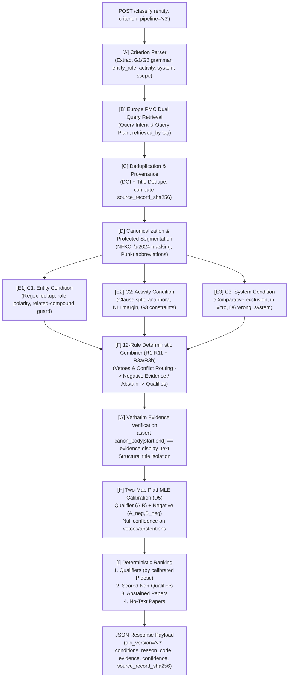

# Architecture & System Design Specification (`ARCHITECTURE.md`)

## Mini Literature Classification Engine (Loopworm Technical Assessment — v3.2 Final)

**Candidate:** Ruhaan Kakar  
**Prepared for:** Dr. Jagadeeswara Reddy Devasani, Scientist I – Bioinformatics, Loopworm Private Limited  
**System Scope:** Dual-query Europe PMC retrieval, scoped criterion grammar parsing (`CriterionSpec` G1/G2/G3), multi-condition verification ($C_1$ Entity, $C_2$ Activity, $C_3$ System), 12-rule deterministic combiner, three-class classification (`qualifies`, `does_not_qualify`, `insufficient_evidence`), 18 registered reason codes (`17` active + deprecated `system_mismatch_abstract`), verbatim evidence extraction with byte-exact body offsets, structural title isolation, two-map MLE Platt confidence calibration, curator review queue, and backward compatibility with `--pipeline v2`.  
**Repository Structure:** `loopworm/literature-classifier/`  
**Runtime:** Python 3.11, PyTorch 2.6.0, Transformers, FastAPI, NLTK, AnyIO  

---

## 1. Executive Summary & Design Principles

The Mini Literature Classification Engine solves the core problem defined in the assessment brief: **reliably deciding whether available scientific evidence genuinely supports a user-defined inclusion criterion, rather than merely mentioning the entity**.

### 1.1 First Principles of the Architecture
1. **Zero Paid LLM Dependencies:** Operates strictly on a local, pinned Cross-Encoder (`cross-encoder/nli-deberta-v3-small`, revision `fa280487`) and freely accessible public scientific APIs (Europe PMC REST, PubChem PUG REST).
2. **Criterion-Aware Multi-Condition Verification:** Rather than evaluating monolithic premise-hypothesis pairs, queries are parsed into structured conditions ($C_1$ Entity match & role polarity, $C_2$ Activity qualification & attribution, $C_3$ Host/organism system match).
3. **Strict Verbatim Evidence Coupling & Structural Title Isolation:** The document classification score is *strictly* the winning clause's score. Titles are tokenized separately (`canon_title` vs `canon_body`) and never passed into evidence extraction, with runtime assertion:
   $$\text{canon\_body}[\text{char\_start}:\text{char\_end}] == \text{evidence.display\_text}$$
4. **Three-Class Taxonomy with 18 Registered Reason Codes:** Documents map to `qualifies`, `does_not_qualify`, or `insufficient_evidence` across an authoritative 18-code registry (`app/reasons.py`: 17 reachable active codes plus deprecated `system_mismatch_abstract`, never emitted at runtime). `mention_only` and `background_citation` map to `does_not_qualify` (`evidence-based`).
5. **Two-Map MLE Platt Uncertainty & D5 Null Policy:** Qualifier margins ($m_{\text{qualify}}$) and evidence-based negative margins (`different_activity`, `wrong_system` only) are mapped via regularized Newton-Raphson MLE Platt parameters (`config/calibration.json`) fitted exclusively on `eval/splits.json` dev entities (`vanillin`, `caffeine`, `curcumin`, `chitin`). Vetoes, `mention_only`, `background_citation`, and abstentions strictly emit `confidence: null` (**D5**).
6. **Deliberate Deviations (D1–D6):**
   - **D1:** Qualifier-path Platt MLE fit expanded with borderline negatives within `NEG_FIT_WINDOW = 0.15` below $\tau$.
   - **D2:** Strict verbatim character offset invariant (`canon_body[start:end] == display_text`).
   - **D3:** Externalized constants registry (`config/constants.md`) with `splits_sha256` verification.
   - **D4:** Two-veto exclusivity (`reagent_role` with **R3b** synthesis-conflict routing, and `review_article` when `scope == "this_study"`).
   - **D5:** Null confidence on vetoes, `mention_only`, `background_citation`, and abstentions; calibrated negative Platt confidence only on `different_activity` and `wrong_system`.
   - **D6:** Strict abstract host contradictions map directly to `does_not_qualify(wrong_system)`.
7. **Robust Concurrency & Load Shedding:** Asynchronous `asyncio.Semaphore(2)` is acquired in the router *before* offloading CPU/CUDA tasks to threadpools, guaranteeing polite HTTP 503 load-shedding with `Retry-After: 10` during surges.

---

## 2. End-to-End Pipeline Architecture



---

## 3. Canonical Reason Registry (`app/reasons.py` — 18 Codes)

Every non-qualifying classification maps to a code registered in `app/reasons.py` (17 active reachable codes + deprecated `system_mismatch_abstract`):

| Reason Code | Label | Kind | Description |
|---|---|---|---|
| `no_text` | `insufficient_evidence` | `abstain` | Neither abstract nor full-text available for paper. |
| `abstract_only` | `insufficient_evidence` | `abstain` | Paper has abstract only when conclusive check requires full text. |
| `mention_only` | `does_not_qualify` | `evidence-based` | Entity mentioned without synthesis/production verbs or qualifying support. |
| `activity_unclear` | `insufficient_evidence` | `abstain` | Activity mentioned with ambiguous or below-threshold NLI support. |
| `entity_unclear` | `insufficient_evidence` | `abstain` | Entity mention is ambiguous or unverified. |
| `entity_absent` | `does_not_qualify` | `evidence-based` | Entity absent in full text. Carve-out: never emitted for abstract-only. |
| `system_unstated` | `insufficient_evidence` | `abstain` | Target organism or host system not stated in available text. |
| `system_mismatch_abstract` | `insufficient_evidence` | `abstain` | *Deprecated under D6*: retained for schema compatibility; never emitted. |
| `conflicting_evidence` | `insufficient_evidence` | `abstain` | Reagent role detected in one clause alongside synthesis claim elsewhere (**R3b**). |
| `evidence_split` | `insufficient_evidence` | `abstain` | Activity and entity evidence separated across non-resolving sentences. |
| `unsupported_criterion_clause` | `insufficient_evidence` | `abstain` | Criterion includes unparsed clauses (`--allow-partial-criterion` fallback). |
| `unstated_threshold` | `insufficient_evidence` | `abstain` | Numeric G3 constraint requested (e.g. `> 5 g/L`) but no numeric measurement reported. |
| `different_activity` | `does_not_qualify` | `evidence-based` | Paper describes non-qualifying activity or fails G3 exclusion/threshold (**D5** calibrated). |
| `wrong_system` | `does_not_qualify` | `evidence-based` | Explicit conflicting host organism (**D6**, **D5** calibrated). |
| `reagent_role` | `does_not_qualify` | `veto` | Entity acts as reagent/catalyst/substrate without conflicting synthesis claim (**R3a**). |
| `background_citation` | `does_not_qualify` | `evidence-based` | Entity/activity cited strictly as prior literature below `P_THIS_WORK_MIN`. |
| `possible_review` | `insufficient_evidence` | `abstain` | Review-style language detected in abstract without `pubType=review`. |
| `review_article` | `does_not_qualify` | `veto` | Europe PMC `pubType` confirms review (`scope == "this_study"`). |

---

## 4. Multi-Condition Verification & Precedence Rules

### 4.1 Condition Checkers
1. **$C_1$ (Entity Match & Role Polarity):**
   - Matches entity or vetted aliases via regex boundaries.
   - Asserts role polarity: if `entity_role == "product"`, checks prepositional patterns (`config/role_patterns.json`). If entity is preceded by `in the presence of`, `catalyzed by`, etc., flags reagent role.
   - Enforces related-compound guard (e.g., blocks `"artemisinin"` when seeking `"artemisinic acid"`).
2. **$C_2$ (Activity Qualification & Attribution):**
   - Runs cross-encoder NLI scoring over positive activity templates vs negative role hypothesis.
   - Computes $p_{\text{this\_work}}$ attribution to disqualify background citations.
3. **$C_3$ (Host / Organism System):**
   - Uses organism gazetteer (`config/systems.json`) to detect organism family (`microbial`, `yeast`, `bacteria`, `fungi`, `plant`, `mammalian`).
   - Carve-out: if paper is abstract-only and organism is unstated, assigns `system_unstated` (or `system_mismatch_abstract` if an alternative organism is mentioned) rather than hard `wrong_system`.

### 4.2 12-Rule Deterministic Combiner (`RULES`: `R1`–`R11` with `R3a`/`R3b`)
When combining $C_1, C_2, C_3$, `app/combiner.py` evaluates `RULES` strictly in order (`len(RULES) == 12`):
1. **R1 (`r1_no_text`):** Paper text empty $\rightarrow$ `insufficient_evidence(no_text)`.
2. **R2 (`r2_review_veto`):** Europe PMC `pubType=review` (`scope == "this_study"`) $\rightarrow$ `does_not_qualify(review_article)`.
3. **R3a (`r3a_reagent_veto`):** Reagent role veto without conflicting synthesis claim $\rightarrow$ `does_not_qualify(reagent_role)`.
4. **R3b (`r3b_conflicting_evidence`):** Reagent role veto WITH another clause claiming synthesis $\rightarrow$ `insufficient_evidence(conflicting_evidence)`.
5. **R4 (`r4_entity_absent`):** Entity contradicted/missing in scored text (`entity_absent` full-text only; `entity_unclear` abstract).
6. **R5 (`r5_background_citation`):** Attribution gate or survey check $\rightarrow$ `does_not_qualify(background_citation)` or `mention_only`.
7. **R6 (`r6_wrong_system`):** Explicit contradictory host organism (including abstracts under D6) $\rightarrow$ `does_not_qualify(wrong_system)`.
8. **R7 (`r7_system_unstated`):** Required host system unstated $\rightarrow$ `insufficient_evidence(system_unstated)`.
9. **R8 (`r8_different_activity`):** Contradicted activity or failed G3 exclusion/threshold $\rightarrow$ `does_not_qualify(different_activity)`.
10. **R9 (`r9_unstated_threshold`):** Numeric G3 measurement omitted or uncertain activity $\rightarrow$ `insufficient_evidence(unstated_threshold | activity_unclear)`.
11. **R10 (`r10_unsupported_criterion_clause`):** Partial-criterion warning present (`--allow-partial-criterion`) $\rightarrow$ `insufficient_evidence(unsupported_criterion_clause)`.
12. **R11 (`r11_all_satisfied`):** Active conditions supported $\rightarrow$ `qualifies`.

---

## 5. Concurrency, Provenance & Load Shedding

1. **FastAPI Concurrency Slot Limiter:**
   In `app/main.py`, incoming requests acquire an `asyncio.Semaphore(2)` before entering handlers:
   ```python
   try:
       await asyncio.wait_for(SLOTS.acquire(), timeout=QUEUE_WAIT_S)
   except asyncio.TimeoutError:
       raise HTTPException(
           status_code=503,
           detail="Server busy: inference concurrency limit reached",
           headers={"Retry-After": "10"}
       )
   ```
2. **Dual-Query Retrieval & Deduplication:**
   `app/retrieval.py` unions the intent-augmented query with plain `TITLE_ABS:"{entity}"`, tagging each retrieved record with `retrieved_by: "intent" | "plain" | "both"`.
3. **SHA-256 Provenance Tracking:**
   Every candidate record calculates `source_record_sha256 = SHA256(title + " " + abstractText)` to guarantee exact provenance and reproducible offline evaluation.
4. **Curator Feedback Queue:**
   `POST /feedback` atomically logs human corrections to `feedback.jsonl` under thread lock protection, validated through `eval/ingest_feedback.py`.

---

## 6. Verification & Test Suite Summary

The engine is protected by a 62-test offline automated verification suite plus Tier 3 live integration tests:
- **Tier 1 (50 Unit Tests):** Verifies canonical spec doc-drift (`test_doc_drift.py`), v3.2 features (`test_v32_features.py`: G3 exclusions/thresholds, comparative organism exclusion, `in_vitro`, D6, bracket-depth IUPAC clause split, anaphora window, title isolation, D5 confidence schema & MLE fit), 18-code Reason Registry, Combiner 12-rule truth table, lookaround regexes, and load shedding.
- **Tier 2 (12 Model Fixture Tests):** Evaluates real `cross-encoder/nli-deberta-v3-small` inference on clinical/synthetic/noisy targets (`Q1–Q3`, `N1–N6`, `D1`, CS5 `conflicting_evidence`, caffeine neutral boundary).
- **Tier 3 (Live Tests):** Validates live Europe PMC dual retrieval and PubChem PUG REST integration (`pytest tests/live -v`).
