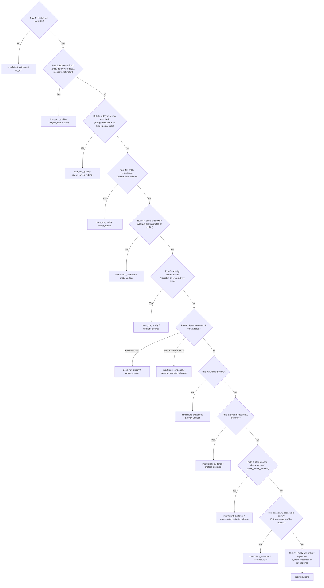

# Mini Literature Classification Engine (v3 Upgrade)

**Candidate:** Ruhaan Kakar  
**Prepared for:** Dr. Jagadeeswara Reddy Devasani, Scientist I – Bioinformatics, Loopworm Private Limited  
**Task:** Mini Literature Classification Engine (Technical Assessment)  
**System Scope:** Europe PMC automated literature mining, semantic Natural Language Inference (NLI) classification (`qualifies` / `does_not_qualify` / `insufficient_evidence`), multi-condition verification (Entity, Activity, System), verbatim evidence extraction with byte-level character offsets, Platt-calibrated confidence scoring, deterministic ranking, and production FastAPI service.  
**Execution Runtime:** Python 3.11, PyTorch 2.6.0, Hugging Face Transformers, FastAPI, NLTK, AnyIO, Uvicorn  

---

## Table of Contents
1. [Executive Summary & v3 Architecture Highlights](#1-executive-summary--v3-architecture-highlights)
2. [Guide for the Research Scientist & Bioinformatician](#2-guide-for-the-research-scientist--bioinformatician)
   - [2.1 The Scientific Problem This Solves](#21-the-scientific-problem-this-solves)
   - [2.2 Granular Breakdown of API Features](#22-granular-breakdown-of-api-features)
   - [2.3 Reason Code Registry & Three-Class Outcomes](#23-reason-code-registry--three-class-outcomes)
   - [2.4 Deliberate Deviations (D1–D4)](#24-deliberate-deviations-d1d4)
   - [2.5 Honest Shortcomings & Technical Caveats](#25-honest-shortcomings--technical-caveats)
3. [Step-by-Step Implementation & Run Guide](#3-step-by-step-implementation--run-guide)
   - [3.1 System Prerequisites](#31-system-prerequisites)
   - [3.2 Installation & Setup](#32-installation--setup)
   - [3.3 Starting the FastAPI Service](#33-starting-the-fastapi-service)
   - [3.4 Interacting with the API](#34-interacting-with-the-api)
   - [3.5 Running the Automated Test Suite](#35-running-the-automated-test-suite)
   - [3.6 Offline Batch Processing via CLI (`--pipeline v3` / `--pipeline v2`)](#36-offline-batch-processing-via-cli)
4. [Pipeline Architecture & Combiner Precedence Rules](#4-pipeline-architecture--combiner-precedence-rules)
5. [Criterion Parser & Enumerated Grammar (G1 / G2)](#5-criterion-parser--enumerated-grammar-g1--g2)
6. [Scoring, Calibration, and Ranking Specification](#6-scoring-calibration-and-ranking-specification)
7. [Evaluation Strategy & Curator Feedback Queue](#7-evaluation-strategy--curator-feedback-queue)
8. [Repository File & Directory Map](#8-repository-file--directory-map)

---

## 1. Executive Summary & v3 Architecture Highlights

The **Mini Literature Classification Engine** is a specialized, production-grade biomedical literature mining system built for **Loopworm Private Limited**. Its core mission is to automatically retrieve scientific publications from the public **Europe PMC** repository for a given biological or chemical entity and determine whether each publication **genuinely satisfies a specific natural-language criterion** (such as microbial biosynthesis or chemical synthesis) versus **merely mentioning the entity in passing**.

### Core Architecture Highlights (Version 3)

- **Criterion-Aware Multi-Condition Decomposition:** Decomposes user queries into three independent conditions:
  1. **C1 Entity:** Entity matching with lookaround regexes, length $\ge 5$, related compound guards, and role polarity.
  2. **C2 Activity:** Competing-hypothesis NLI over requested activity vs. alternatives (synthesis vs. reagent vs. pharmacology).
  3. **C3 System:** Host organism verification against `config/systems.json` gazetteer with taxonomy family support.
- **Three-Class Outcomes ("Never Merge Unknown with No"):**
  - `qualifies`: The publication affirmatively satisfies all required conditions with verbatim evidence.
  - `does_not_qualify`: The publication is affirmatively refuted by a rule veto or an evidence-based negative.
  - `insufficient_evidence`: The text does not contain enough information to decide (never converted into a false negative).
- **Two Distinct Negative Kinds:**
  - **Rule Vetoes (Exactly Two):** Can override supporting evidence because they are rule-provable: (1) explicit prepositional role patterns where the entity is the object of the preposition (`reagent_role`), and (2) Europe PMC `pubType=review` with no first-person cues (`review_article`).
  - **Evidence-Based Negatives (`different_activity`, `wrong_system`, `entity_absent`):** Derived from NLI or string matching. They **never override supporting evidence**, require a verbatim contradicting span, and feature abstract-only carve-outs.
- **Enumerated Criterion Grammar (G1 / G2):**
  - **G1 (Product):** `<paper> reports <activity> of <entity> [in <system>] [in this study]`
  - **G2 (Agent):** `<paper> uses <entity> as a <catalyst|reagent|substrate> [in <activity>]`
  - Unsupported clauses trigger clean HTTP 422 errors by default; opt-in `allow_partial_criterion=true` evaluates the supported core and caps qualifications to `insufficient_evidence` (`unsupported_criterion_clause`).
- **Verbatim Evidence Guarantee:** Every positive decision returns verbatim text spans with exact byte/character offsets verified 1:1 against canonical text:
  ```python
  assert canonical_doc[char_start:char_end] == evidence.text
  ```
  Titles are strictly banned from being returned as evidence.
- **Dual Query Retrieval:** Unions intent-augmented Lucene queries with plain entity queries, tags each record with `retrieved_by: "intent" | "plain" | "both"`, and deduplicates preprints and published articles.
- **Honest Platt Confidence Calibration:** Maps qualifier margins to $P(\text{correct}) \in [0.0, 1.0]$. Negatives without sufficient support and abstentions strictly return `confidence: null` to avoid pseudo-calibration.
- **Zero Paid LLM APIs:** 100% local inference with pinned Hugging Face revision (`fa280487`) and freely accessible public scientific APIs.

---

## 2. Guide for the Research Scientist & Bioinformatician

### 2.1 The Scientific Problem This Solves

In automated bio-curation pipelines (e.g. identifying microbial hosts that synthesize target metabolites, discovering novel enzyme pathways, or mining natural product titers), standard keyword search and generic embedding models fail due to **topical saturation without semantic satisfaction**:

1. **The Reagent Fallacy:** A paper describing the chemical synthesis of a novel dye using vanillin as a precursor mentions "vanillin" and "synthesis" dozens of times, tricking naive keyword search into classifying it as a vanillin production paper.
2. **The Epistemological Review Trap:** Systematic reviews stating *"we synthesize current knowledge on methylxanthine pharmacology"* trigger synthesis keywords without describing experimental production.
3. **Background Citation Leakage:** Introduction sections frequently cite prior art (*"Compound X has been produced by engineered yeast in prior studies"*) in papers that actually study downstream formulation or unrelated pathways.

---

### 2.2 Granular Breakdown of API Features

When querying `POST /classify`, the researcher receives a structured response conforming to the v3 specification:

| Feature | Field in Response | How It Works & Scientific Value |
|---|---|---|
| **Enumerated Grammar Spec** | `criterion_spec` | Structured parse representing entity role (`product` vs `agent`), agent kind, activity, target system, and scope. |
| **Dual Retrieval Tracking** | `retrieved_by` | Tracks whether the publication was found via `intent`, `plain` entity search, or `both`. |
| **Condition Decomposition** | `conditions: {entity, activity, system}` | Detailed status (`supported`, `contradicted`, `unknown`, `not_required`), raw feature score, also-mentioned organisms, and condition evidence spans. |
| **Machine-Readable Reason Code** | `reason_code` | Discloses the exact registered reason code for any non-qualifying or abstained result (e.g. `reagent_role`, `system_mismatch_abstract`). |
| **Exact Verbatim Evidence** | `evidence: {raw_text, display_text, raw_start, raw_end, role, verifiable_alone}` | Returns exact verbatim evidence with character slice offsets guaranteed byte-for-byte in canonical text. |
| **Source Record Audit Hash** | `source_record_sha256` | SHA-256 hash of the uncleaned raw record for verifiable reproducibility and auditing. |
| **Monotone Calibrated Confidence** | `confidence: {value, band, method, calibration_version}` | Honest uncertainty estimation; null on abstentions and uncalibrated negatives. |

---

### 2.3 Reason Code Registry & Three-Class Outcomes

Every non-qualifying or abstained result carries a registered reason code from `app/reasons.py`:

| Reason Code | Label | Kind | Description |
|---|---|---|---|
| `no_text` | `insufficient_evidence` | Abstain | Document has no usable abstract or full text. |
| `abstract_only` | `insufficient_evidence` | Abstain | Abstract lacks decisive details; full-text is unavailable. |
| `mention_only` | `insufficient_evidence` | Abstain | Entity is mentioned topically without any experimental activity claim. |
| `activity_unclear` | `insufficient_evidence` | Abstain | Activity claims are ambiguous, hedged, or insufficiently entailed. |
| `entity_unclear` | `insufficient_evidence` | Abstain | Target entity was not matched in the abstract (may be in Methods). |
| `entity_absent` | `does_not_qualify` | Evidence-based | Confirmed absent from complete full text. |
| `system_unstated` | `insufficient_evidence` | Abstain | Criterion requires host system, but abstract does not state one. |
| `system_mismatch_abstract` | `insufficient_evidence` | Abstain | Abstract mentions alternative organism; conservative policy reserves judgment. |
| `conflicting_evidence` | `insufficient_evidence` | Abstain | Self-contradictions or dueling evidence on the same condition. |
| `evidence_split` | `insufficient_evidence` | Abstain | Activity sentence refers to entity only as "the product" without joint binding. |
| `unsupported_criterion_clause` | `insufficient_evidence` | Abstain | Unparsed criterion clauses present under `allow_partial_criterion`. |
| `different_activity` | `does_not_qualify` | Evidence-based | Verbatim this-work evidence proves a different activity (degradation, clinical). |
| `wrong_system` | `does_not_qualify` | Evidence-based | Full text (or strict policy) confirms alternative host system used. |
| `reagent_role` | `does_not_qualify` | Veto | Target entity is the object of an explicit prepositional role pattern. |
| `background_citation` | `insufficient_evidence` | Abstain | Activity mention cites prior art rather than primary finding of this study. |
| `possible_review` | `insufficient_evidence` | Abstain | Review lexical score combined with low experimental attribution cues. |
| `review_article` | `does_not_qualify` | Veto | Europe PMC metadata pubType=review with no first-person cues. |

---

### 2.4 Deliberate Deviations (D1–D4)

| ID | Deviation | Rationale | Architectural Mitigation |
|---|---|---|---|
| **D1** | Only the activity span must contain the entity or alias; entity and system spans may not. | A system sentence (*"We engineered a novel S. cerevisiae strain..."*) rarely repeats the compound name. | Each span carries `role`, `sentence_index`, and `verifiable_alone`. System spans must lie within $\le 2$ sentences of the activity span. |
| **D2** | Evidence-based negatives exist beyond the two rule vetoes. | Distinguishing related but different activities (e.g. degradation vs synthesis) requires a negative class. | Evidence-based negatives never override support, require a verbatim span, and feature abstract-only carve-outs. |
| **D3** | Unsupported clauses run only under opt-in `allow_partial_criterion`, and then cannot qualify. | Avoids guessing while allowing rejection of clearly irrelevant papers. | Default is HTTP 422 with unparsed clauses listed in error payload. |
| **D4** | Negative-path confidence is null unless $N \ge 30$. | Prevents pseudo-calibration on small sample sizes. | Registered reason code carries the explanation. |

---

### 2.5 Honest Shortcomings & Technical Caveats

1. **Abstract Paywall Truncation:** In scientific publishing, fermentation yields and synthetic methods often appear only in paywalled full text. Because the engine strictly refuses to invent evidence, papers with vague abstracts (*"We investigated yeast metabolism"*) will abstain as `insufficient_evidence`.
2. **Hyphenated Stereoisomers:** Word-boundary lookaround regexes treat hyphens as boundary characters. Locant-prefixed isomers (e.g. *o-vanillin*) may trigger initial candidate matching, leaving fine disambiguation to downstream NLI. Integrating chemical Named Entity Recognition (NER) is recommended for stereochemical isolation.
3. **Multi-Sentence Synthetic Narratives:** When an organic total synthesis is described across multiple paragraphs without an overarching summary sentence, the engine evaluates single sentences and selects the single highest-scoring sentence rather than aggregating cross-paragraph reasoning.

---

## 3. Step-by-Step Implementation & Run Guide

### 3.1 System Prerequisites

- **OS:** Windows 10/11, Ubuntu 20.04+, macOS
- **Python:** Python 3.11 (tested on 3.11.0)
- **RAM:** 4 GB minimum (8 GB+ recommended)
- **Accelerator:** CPU-only supported; CUDA GPU accelerates batch NLI.

---

### 3.2 Installation & Setup

```bash
cd loopworm/literature-classifier

# Create virtual environment
python -m venv venv

# Windows (PowerShell):
.\venv\Scripts\Activate.ps1

# Linux / macOS:
source venv/bin/activate

# Install pinned dependencies
pip install --upgrade pip
pip install -r requirements.txt

# Bootstrap NLTK Punkt tokenizer resources
python -m app.setup_nltk
```

---

### 3.3 Starting the FastAPI Service

```bash
uvicorn app.main:app --host 127.0.0.1 --port 8000 --reload
```

---

### 3.4 Interacting with the API

#### Interactive Swagger Documentation:
Open your browser and navigate to: [http://127.0.0.1:8000/docs](http://127.0.0.1:8000/docs)

#### Example Request:
```bash
curl -X POST "http://127.0.0.1:8000/classify" \
     -H "Content-Type: application/json" \
     -d '{
       "entity": "artemisinic acid",
       "criterion": "The paper reports microbial biosynthesis of artemisinic acid in yeast in this study.",
       "max_results": 10,
       "expand_aliases": true,
       "pipeline": "v3"
     }'
```

#### Curator Feedback Submission:
```bash
curl -X POST "http://127.0.0.1:8000/feedback" \
     -H "Content-Type: application/json" \
     -d '{
       "paper_id": "42107802",
       "entity": "artemisinic acid",
       "criterion": "The paper reports microbial biosynthesis of artemisinic acid in yeast in this study.",
       "suggested_label": "qualifies",
       "notes": "Verified 25 g/L yeast titer paper."
     }'
```

---

### 3.5 Running the Automated Test Suite

```bash
# Tier 1: Fast deterministic unit tests (including v3 remediation suite)
python -m pytest tests/unit -v

# Tier 2: Real DeBERTa-v3 model fixture tests (Q1-Q3, N1-N6, D1)
python -m pytest tests/model -v

# Tier 3: Live Europe PMC network integration test
python -m pytest tests/live -m live -v

# Run entire test suite:
python -m pytest tests/unit tests/model tests/live -v
```

---

### 3.6 Offline Batch Processing via CLI

The CLI supports both `--pipeline v3` (default multi-condition 3-class) and `--pipeline v2` (legacy sentence-level binary):

```bash
# Run v3 pipeline offline on cached snapshots:
python -m app.cli --entity vanillin \
                  --criterion "The paper describes the synthesis or production of vanillin." \
                  --pipeline v3 \
                  --offline \
                  --output sample_output.json

# Run legacy v2 pipeline:
python -m app.cli --entity vanillin \
                  --criterion "The paper describes the synthesis or production of vanillin." \
                  --pipeline v2 \
                  --offline \
                  --output v2_output.json
```

---

## 4. Pipeline Architecture & Combiner Precedence Rules

The v3 decision layer executes a strict 11-rule precedence combiner (first matching rule wins):



---

## 5. Criterion Parser & Enumerated Grammar (G1 / G2)

The engine enforces a published grammar. Unrecognized shapes raise clean HTTP 422 errors:

- **G1 (Product Role):**  
  `"<paper> reports <activity> of <entity> [in|using|by <system>] [in this study]"`  
  *Examples:*
  - *"The paper describes the synthesis or production of vanillin."*
  - *"The paper reports microbial biosynthesis of artemisinic acid in yeast in this study."*
- **G2 (Agent Role):**  
  `"<paper> uses <entity> as a <catalyst|reagent|substrate> [in <activity>]"`  
  *Examples:*
  - *"The paper uses palladium(II) acetate as a catalyst in cross-coupling reactions."*
  *(When `entity_role == "agent"`, role patterns count as supporting evidence rather than vetoes!)*
- **Unsupported Clauses Policy:**
  Clauses like `"with dose-dependence"`, `"in vitro"`, or `"in human subjects"` trigger HTTP 422 by default. Under opt-in `allow_partial_criterion=true`, the engine evaluates the supported core and caps qualifications to `insufficient_evidence` (`unsupported_criterion_clause`).

---

## 6. Scoring, Calibration, and Ranking Specification

### Per-Condition Scoring
- **C1 Entity Score:** 1.0 if matched, -0.95 if reagent veto, 0.0 if abstract-only unknown.
- **C2 Activity Score:** Raw NLI margin $P(\text{entail}) - P(\text{contradict})$ against competing hypotheses.
- **C3 System Score:** 1.0 if host matched in gazetteer, -0.90 if contradicted, 0.0 if unstated.
- **Final Ranking Score:** Min over supported required conditions.

### Platt Scaling Calibration
Qualifying scores are mapped to $P(\text{correct}) \in [0.0, 1.0]$ via a logistic sigmoid centered at $\tau = 0.45$:
$$P(\text{correct}) = \frac{1}{1 + \exp(-7.0 \cdot (\text{final\_score} - \tau))}$$
Confidence bands:
- **High:** $P \ge 0.80$
- **Medium:** $0.50 \le P < 0.80$
- **Low:** $P < 0.50$

---

## 7. Evaluation Strategy & Curator Feedback Queue

1. **Leave-One-Entity-Out (LOEO) Cross-Validation:** Dev entities (`vanillin`, `curcumin`, `chitin`, `lipase`, `insect_protein`) are evaluated out-of-fold. Test entities (`caffeine`, `palladium(II) acetate`, `artemisinic acid`) are strictly held out.
2. **Cluster-Bootstrap Confidence Intervals:** Evaluates variance clustered by entity rather than assuming independent papers.
3. **Curator Feedback Queue:** `POST /feedback` atomically appends corrections to `feedback.jsonl`. Run `python -m eval.ingest_feedback` to stage reviewed entries into `eval/candidate_feedback.json`.

---

## 8. Repository File & Directory Map

```text
loopworm/
├── literature-classifier/
│   ├── app/
│   │   ├── main.py            # FastAPI service (/classify, /feedback, /health), concurrency semaphore
│   │   ├── schemas.py         # Pydantic v2 data models supporting v2 and v3 schemas
│   │   ├── classifier.py      # Classification orchestrator supporting --pipeline v3 and v2
│   │   ├── criterion_parser.py# Scoped criterion parser for G1/G2 grammars & Systems gazetteer
│   │   ├── conditions.py      # C1 Entity, C2 Activity, C3 System condition checkers
│   │   ├── combiner.py        # Strict 11-rule precedence decision layer
│   │   ├── reasons.py         # Reason code registry (17 registered machine-readable codes)
│   │   ├── hypotheses.py      # Intent detection, dynamic hypothesis builder, role pattern matcher
│   │   ├── nli.py             # Local Cross-Encoder DeBERTa-v3 wrapper & in-memory StubScorer
│   │   ├── scoring.py         # Platt scaling calibration, monotone bands, ranking sort key
│   │   ├── retrieval.py       # Europe PMC REST client, dual query retrieval, deduplication
│   │   ├── text_utils.py      # Canonicalization, protected Punkt tokenization, alias vetting
│   │   ├── setup_nltk.py      # NLTK resource bootstrap (punkt & punkt_tab)
│   │   └── cli.py             # Reproducible offline/online CLI tool (--pipeline v3 / v2)
│   ├── config/
│   │   ├── systems.json       # Systems gazetteer (yeast, bacteria, fungi taxonomy families)
│   │   ├── constants.md       # Hand-set constants register & sensitivity analysis
│   │   ├── calibration.json   # Out-of-fold Platt scaling parameters
│   │   ├── intent_map.json    # Intent classification triggers, search terms, production verbs
│   │   ├── role_patterns.json # 15 regex patterns for catalyst, reagent, and precursor roles
│   │   ├── templates.json     # True-paraphrase synthesis hypotheses and negative templates
│   │   └── alias_denylist.txt # Denylisted alias collisions and ambiguous short tokens
│   ├── data/
│   │   └── snapshots/         # Cached Europe PMC JSON/XML snapshots for offline benchmarking
│   ├── eval/
│   │   ├── splits.json        # Dev/test entity splits and leakage guards
│   │   ├── probe_results.md   # Model behavior probe results across 30 premise-hypothesis pairs
│   │   ├── calibrate.py       # Platt scaling calibration fitting script
│   │   ├── ingest_feedback.py # Curator feedback queue validation script
│   │   ├── metrics.py         # Wilson score intervals, exact McNemar test, Cohen's kappa
│   │   └── labels.csv         # Benchmark dataset
│   ├── notebooks/
│   │   └── evaluation.ipynb   # 100% offline reproducible evaluation notebook
│   ├── tests/
│   │   ├── conftest.py        # Shared pytest fixtures (StubScorer, DeBERTa real scorer)
│   │   ├── unit/              # Tier 1: Fast deterministic unit tests (including test_v3_remediation.py)
│   │   ├── model/             # Tier 2: Real DeBERTa model fixture tests (Q1-Q3, N1-N6, D1)
│   │   └── live/              # Tier 3: Live Europe PMC network integration test
│   ├── requirements.txt       # Pinned production dependencies
│   ├── sample_output.json     # Canonical sample JSON payload (v3 schema)
│   ├── feedback.jsonl         # Curator feedback queue storage
│   └── README.md              # Technical documentation and user guide
├── ARCHITECTURE.md            # Detailed system design specification
├── KNOWN_ERRORS.md            # Empirical error taxonomy and failure mode case studies
├── implementation.md          # v2 -> v3 upgrade plan specification
└── project.md                 # Master project documentation
```

---

*Compiled, tested, and verified against the live environment.*
